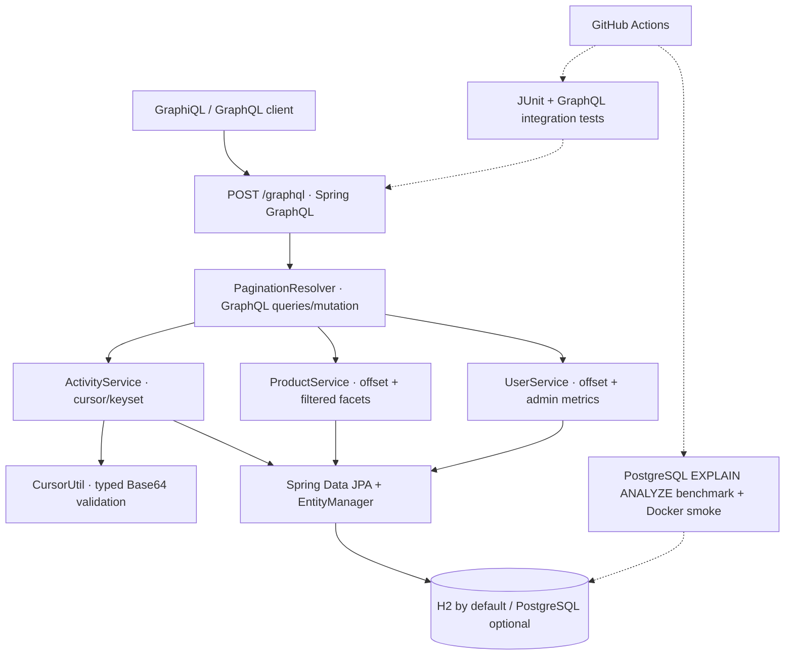
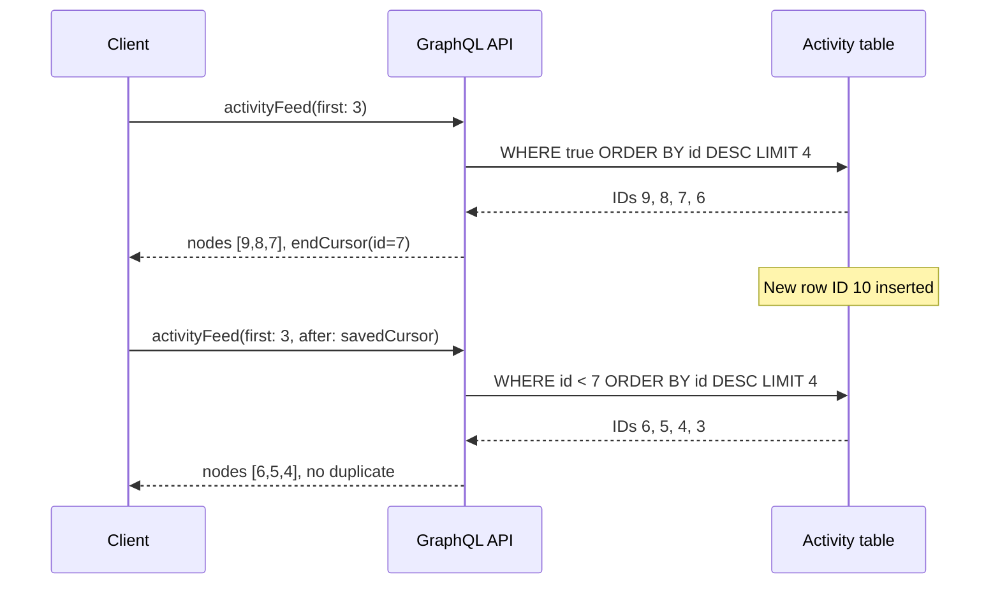

# GraphQL Pagination Strategies

**A hands-on Java/Spring GraphQL project comparing offset pagination with cursor-based keyset pagination—through working endpoints, consistency tests and reproducible PostgreSQL benchmarks.**

[](https://github.com/kakarot987/graphQL-pagination-strategies/actions/workflows/tests.yml)
[](https://github.com/kakarot987/graphQL-pagination-strategies/actions/workflows/postgres-benchmark.yml)

**Java 21 · Spring Boot 3.3 · Spring for GraphQL · Spring Data JPA · H2 / PostgreSQL · Docker · Gradle · GitHub Actions**

> **Core question:** What changes when a feed receives new rows between page requests, and how does query cost change as users navigate deeper into a dataset?

[Quick start](#quick-start) · [Architecture](#architecture) · [Compare strategies](#offset-vs-cursor-pagination) · [Measured benchmark](#measured-postgresql-benchmark) · [System-design deep dive](docs/SYSTEM_DESIGN.md) · [Interview notes](docs/INTERVIEW_GUIDE.md)

## What this project demonstrates

| Workload | GraphQL query | Pagination strategy | Why it fits |
| --- | --- | --- | --- |
| Activity timeline | `activityFeed(first, after, filter)` | **Cursor / keyset** | Seek after a known ID; avoids the common new-head insertion shift |
| Product catalog | `products(page, size, filter, sort)` | **Offset** | Supports numbered pages and direct page jumps |
| Admin users | `adminUsers(page, size, filter, sort)` | **Offset** | Works with page counts, sorting and dashboard metrics |
| Activity comparison demo | `activityFeedOffset(page, size)` | **Offset** | Shows the same feed's page boundary shifting after an insert |

The project includes a saved-cursor-versus-offset demonstration, filter-aware product facets and price aggregates, typed cursor validation, integration tests, automated PostgreSQL smoke tests and a **250,000-row indexed benchmark**. It is an educational demo, **not** a production-ready commerce or admin service.

## Architecture



**Request flow:** the resolver converts GraphQL arguments to service inputs; services validate pagination, build JPA criteria or specifications and shape `edges`, `nodes`, `pageInfo` and metadata. Product/user services use `PageRequest`. The activity feed applies its cursor predicate and filters in SQL and limits the item query to `first + 1` rows to determine `hasNextPage`.

**Repository map**

| Location | Responsibility |
| --- | --- |
| `src/main/resources/graphql/schema.graphqls` | GraphQL contracts and connection types |
| `src/main/java/com/portfolio/graphql/resolver/PaginationResolver.java` | GraphQL query/mutation entry points |
| `src/main/java/com/portfolio/graphql/service/` | Pagination, filtering, sorting, aggregates |
| `src/main/java/com/portfolio/graphql/config/CursorUtil.java` | Encodes/validates cursor structure and connection type |
| `src/test/` | Cursor unit tests and GraphQL integration tests |
| `benchmark/` | Indexed dataset, EXPLAIN scripts, repeatable measurement runner |
| `.github/workflows/` | Java CI plus PostgreSQL benchmark/smoke |

See [SYSTEM_DESIGN.md](docs/SYSTEM_DESIGN.md) for SQL shapes, invariants, failure modes, indexing and trade-offs.

## Offset vs cursor pagination

### Offset: fetch a position

```sql
-- Example shape; the real product query can add filters and sort fields.
SELECT * FROM products
ORDER BY name ASC, id ASC
LIMIT 10 OFFSET 100;
```

A request for `page = 10` and `size = 10` skips the first 100 rows. It is straightforward for page numbers, arbitrary jumps and total-page counts. The trade-off is that deeper offsets can require examining/skipping more rows, and inserts/deletes ahead of the boundary can make consecutive pages **duplicate or miss** items.

### Cursor/keyset: fetch after a value

```sql
-- Illustrative SQL equivalent to the implemented activity seek condition.
SELECT * FROM activity_items
WHERE id < :last_seen_id
ORDER BY id DESC
LIMIT :first_plus_one;
```

For the activity feed, the cursor contains a validated type and ID. An indexed ID predicate starts strictly after the saved boundary, so **a new row with a higher ID does not shift the next page**. The extra row reveals whether another page exists. Deep pages can avoid the skip cost of large offsets.



**Important nuance:** this implementation orders the feed by **descending insertion ID, not event timestamp**. It does **not** promise an immutable snapshot under concurrent updates/deletes, support backward `before/last` pagination, or use signed cursors. Base64 encoding is not encryption or authentication. See [consistency details](docs/SYSTEM_DESIGN.md#consistency-under-concurrent-writes).

## Quick start

**Prerequisites:** Java 21 and the included Gradle wrapper. Docker is optional.

```bash
./gradlew test
./gradlew bootRun
# On Windows PowerShell: .\gradlew.bat bootRun
```

Open **[GraphiQL](http://localhost:8080/graphiql)** and run:

```graphql
query {
  activityFeed(first: 3, filter: { activityType: PURCHASE }) {
    edges { cursor node { id username activityType } }
    pageInfo { endCursor hasNextPage }
    totalCount
  }
  products(page: 0, size: 5, filter: { category: "Electronics" }) {
    nodes { id name price }
    categoryFacets { name count }
    priceRange { min max average }
    pageInfo { currentPage totalPages hasNextPage }
  }
}
```

For the **cursor-stability demonstration**, leave the server running and execute `.\demo.ps1` in PowerShell. It saves a cursor, captures both second pages, inserts an activity and checks that the cursor page remains stable while the offset page shifts.

### Docker

```bash
# Default H2 app on http://localhost:8080/graphql
docker compose up --build

# Optional PostgreSQL app on http://localhost:8081/graphql
docker compose --profile postgres up --build -d postgres graphql-postgres
```

H2 and PostgreSQL profiles both seed small sample datasets for development. The PostgreSQL profile uses `create-drop` and demo credentials—do **not** point it at important data.

## Measured PostgreSQL benchmark

The [benchmark workflow](https://github.com/kakarot987/graphQL-pagination-strategies/actions/runs/43594538554) executed an indexed **250,000-row** synthetic dataset on **PostgreSQL 16** using a GitHub Actions runner. It checked that offset and keyset queries returned **identical 20-row pages**, warmed both paths, and used the median of five `EXPLAIN (ANALYZE, BUFFERS, FORMAT JSON)` execution times per depth.

| Rows skipped / depth | Offset median | Keyset median |
| ---: | ---: | ---: |
| 0 | 0.052 ms | 0.047 ms |
| 1,000 | 0.183 ms | 0.045 ms |
| 10,000 | 1.411 ms | 0.062 ms |
| 100,000 | 13.511 ms | 0.062 ms |
| 200,000 | 26.793 ms | 0.072 ms |

At depth 200,000, offset was **about 372× slower than indexed keyset** for **this query on this runner** (26.793 / 0.072). This is **database query execution time**, not GraphQL response latency or a guaranteed result on other hardware, schemas or workloads.

**How to reproduce:**

```bash
docker compose --profile postgres up -d postgres
docker compose exec -T postgres psql -v ON_ERROR_STOP=1 -U pagination -d pagination < benchmark/01_seed.sql
python3 benchmark/run_benchmark.py
```

The runner writes `benchmark/results/summary.md` and `samples.csv`; these were uploaded as a workflow artifact in the [successful run](https://github.com/kakarot987/graphQL-pagination-strategies/actions/runs/43594538554). See [benchmark/README.md](benchmark/README.md) for method and caveats.

## Correctness & testing

- **Input limits:** `page >= 0`; offset `size` and feed `first` must be 1–100.
- **Stable tie order:** offset sorting appends ascending `id` where sort values tie; this avoids nondeterministic ordering on a fixed dataset, **not** drift from concurrent writes.
- **Cursor validation:** bad Base64 structure, negative IDs or the wrong connection type raise errors rather than silently restarting pagination.
- **Filter semantics:** activity type, user ID and timestamp bounds apply to the feed query and filtered `totalCount`; product facets and price aggregates apply active catalog filters.
- **Tests:** GraphQL integration tests exercise cursors, saved-cursor inserts, offset drift, filters, sort tie-breakers, bound validation and empty states.
- **CI:** [Java tests](.github/workflows/tests.yml) run on pull requests and pushes to `main`; [PostgreSQL benchmark and smoke](.github/workflows/postgres-benchmark.yml) runs on relevant changes and can be triggered manually.

## Trade-offs & production boundaries

This project intentionally focuses on **pagination correctness and query behavior**, not a production deployment. The example has no authentication or authorization for admin queries/mutations, and enables developer conveniences such as GraphiQL and H2 console. Cursors are constructible, not signed. The GraphQL schema exposes price/spend as `Float` for demo compatibility even though Java/JPA persist money as `BigDecimal`; financial APIs should use exact decimal representations.

For production, add authz, safe credentials, database migrations, rate limiting, operational observability, tuned composite indexes, and cursor signing if tamper resistance is required. Composite `(timestamp, id)` cursors and bidirectional pagination are extensions, **not implemented features**.

## Interview-ready story

I built two pagination paths against the same Spring GraphQL stack, tested the effects of concurrent inserts on page boundaries and benchmarked the cost of deep offsets against indexed keyset queries. The choice is workload-specific: **offset for numbered navigation; cursor/keyset for a changing feed**.

See [Interview Guide](docs/INTERVIEW_GUIDE.md) for the project pitch, technical questions, benchmarks to discuss and explicit limitations.

---

**Suggested repository description:** “Spring GraphQL pagination lab: offset vs cursor/keyset, consistency tests, PostgreSQL benchmarks (250K rows), Docker and CI.”
