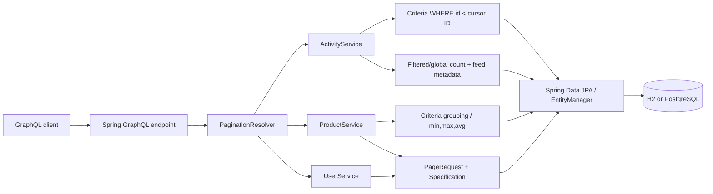
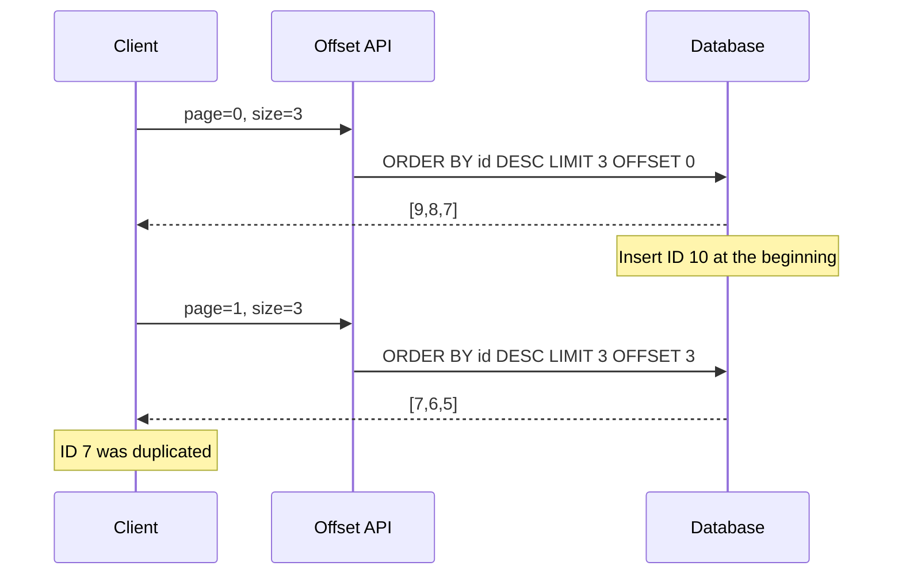

# System design: offset vs cursor/keyset pagination

This guide explains **the design actually implemented** in this repository, distinguishes illustrative SQL from generated JPA SQL, and describes where the guarantees end.

[Back to README](../README.md) · [Interview guide](INTERVIEW_GUIDE.md)

## 1. Problem and workload

A product catalog and an activity feed make different promises to clients.

- A **catalog** often needs jump-to-page navigation, filters, sorting and total page counts. Clients accept that pages reflect the current dataset rather than a long-lived immutable snapshot.
- An **activity feed** often needs a "load more" operation that continues from the last item the user saw, even if newer rows have arrived.

Both approaches use ordering to define pages; the difference is **position versus value**. GraphQL connections provide a uniform response surface, but do not themselves make pagination consistent.

## 2. Component architecture



**GraphQL surface**

| Field | Inputs | Response |
| --- | --- | --- |
| `products` | `page, size, filter, sort` | Product edges/nodes/pageInfo, counts, category facets, price range |
| `adminUsers` | `page, size, filter, sort` | User edges/nodes/pageInfo, counts, admin metrics |
| `activityFeed` | `first, after, filter` | Activity edges/nodes/pageInfo, filtered total count, feed metadata |
| `activityFeedOffset` | `page, size` | Same feed data through offset for an explicit correctness comparison |

## 3. Offset pagination

### SQL shape

With page index `p` (zero-based) and page size `s`, `offset = p × s`.

```sql
-- Illustrative shape for the products path.
SELECT id, name, price, category
FROM products
WHERE category = 'Electronics'
ORDER BY price DESC, id ASC
LIMIT 10 OFFSET 100;
```

The repository uses JPA `PageRequest.of(page, size, sort)` and appends ascending `id` as a tie-breaker. It also exposes total counts and page metadata. Product facet counts use one filtered grouped query, and the price-range aggregate respects the active filters.

**Strengths:** arbitrary page jumps; simple page-number UX; total pages; straightforward admin reporting.

**Costs:** a large offset can force the database to walk/skips many rows; obtaining total counts and aggregates can add queries; writes to earlier positions can move rows across page boundaries.

### Why deterministic sorting does not solve drift

Suppose descending IDs are `[9,8,7,6,5,4]`, with three per page:



Sorting by `id` ensures that equal primary sort values are ordered predictably, but it **does not freeze row positions** across separate requests.

## 4. Cursor/keyset pagination

### Cursor contract and query

An activity cursor contains a type and positive ID encoded as Base64:

```text
cursor:activity:7  -->  base64(cursor:activity:7)
```

The service decodes the token, validates the structure and expected `activity` connection type, then applies the boundary **in the database**:

```sql
-- Illustrative SQL equivalent to the JPA Criteria expression.
SELECT *
FROM activity_items
WHERE id < :decoded_after_id
  -- Optional activity type, user ID and timestamp filters
ORDER BY id DESC
LIMIT :first_plus_one;
```

The additional row is used only to compute `hasNextPage`. Returned edges include the cursor for their own node; `endCursor` is the cursor of the last returned node.

This avoids the **position drift** caused by a new row whose ID is greater than the saved last-seen ID. It also enables the database to seek from an index boundary rather than discarding large prefixes.

### Why ID rather than timestamp?

The current demo orders by **descending insertion ID**, using the primary-key index and `WHERE id < ?`. This is simple for an append-oriented feed, but seeded timestamps are deliberately non-monotonic. The app does **not** claim chronological event-time ordering.

A production feed ordered by event time might need a composite sort and cursor, such as `ORDER BY timestamp DESC, id DESC` together with:

```sql
WHERE (timestamp, id) < (:cursor_timestamp, :cursor_id)
ORDER BY timestamp DESC, id DESC
LIMIT :first_plus_one;
```

This is a **proposed extension**, not the query implemented here. It needs the matching composite index, carefully defined null/tie semantics, and cursor versioning.

## 5. Consistency under concurrent writes

| Concurrent event | Offset behavior | Current ID-keyset behavior |
| --- | --- | --- |
| Insert a **new higher-ID** activity before reading page 2 | Page boundary shifts; prior item can repeat | Saved `id < last_seen` boundary stays stable |
| Delete a row before an offset boundary | Later items may shift/skip | Cursor still seeks by ID, though deleted items vanish |
| Update an item's fields without changing ID | Ordering by ID stays; field values change | Ordering by ID stays; field values change |
| Insert a new row with an **older effective sort value** | May move result positions | Behavior depends on the sort/ID assumptions |
| User changes feed filters between page requests | Results change | Saved cursor alone does not freeze or authenticate filters |
| Full snapshot consistency required | Not provided | Not provided |

Each GraphQL request can see a different committed database state. A keyset cursor identifies a **boundary**, not a transactionally consistent snapshot. Deletions, filter changes, reordering and backdated data still require product-level decisions.

The cursor is **not cryptographically signed**, is not bound to a filter set, and should not be treated as an access-control token. Authorization must be enforced independently.

## 6. Indexes, complexity and performance

A sufficiently selective indexed seek can approach `O(log N + page_size)` index navigation and row retrieval (workload dependent). Deep offset commonly requires examining or skipping `O(offset + page_size)` candidate entries, although actual plans vary by query and index.

The benchmark uses a dedicated 250,000-row PostgreSQL table with a primary-key index and verifies that each pair of queries returns the **same 20 IDs**. It measures `EXPLAIN (ANALYZE, BUFFERS)` execution times, not HTTP latency.

| Depth | Offset median (ms) | Keyset median (ms) |
| ---: | ---: | ---: |
| 0 | 0.052 | 0.047 |
| 1,000 | 0.183 | 0.045 |
| 10,000 | 1.411 | 0.062 |
| 100,000 | 13.511 | 0.062 |
| 200,000 | 26.793 | 0.072 |

**Provenance:** [successful CI benchmark run](https://github.com/kakarot987/graphQL-pagination-strategies/actions/runs/43594538554), PostgreSQL 16, GitHub Actions ubuntu-latest runner, five recorded iterations per depth and strategy after warmup. At depth 200,000, these particular SQL statements show roughly **372×** difference; that ratio must not be represented as an end-to-end or universal improvement.

For realistic production comparisons, benchmark matching filtered/sorted queries with the corresponding composite indexes, cold and warm caches, concurrent inserts, different page sizes and database-level metrics (`BUFFERS`, actual plan, rows read, locks and CPU).

## 7. Query-count and data-model decisions

- **Feed retrieval:** a limited JPA Criteria query fetches at most `first+1` rows. Using `Page<T>` would add an implicit total count in many cases; the service explicitly computes filtered `totalCount` and global metadata as separate queries.
- **Facets:** grouping by category in the database replaces one query per category (a query-count scaling issue). Product price min/max/average is also calculated over the filtered set.
- **Ordering:** offset queries append a unique `id` tie-breaker to user-selected sort fields.
- **Money:** JPA uses `BigDecimal` for product price and user total spend. Existing GraphQL `Float` fields still lose exact decimal representation; prefer decimal strings or integer minor units for real financial transfers.

## 8. API validations and error handling

- Offset page must be non-negative; offset size and cursor first must be in **[1,100]**.
- Product minimum/maximum prices must be finite, nonnegative and ordered; rating minimum is constrained to **0–5**.
- Cursor decoding rejects malformed encodings, incorrect cursor types and nonpositive IDs instead of silently restarting at page one.
- Timestamp filter ranges are validated as ISO-8601 local date-time values (without timezone semantics) and checked for valid ordering.

## 9. What is outside scope

The demo intentionally has no authentication or authorization for the admin resolver and activity mutation, uses seed data, and enables developer tools. It is not a high-availability production service.

A production plan would include:

1. Authorization at GraphQL field/resolver and data layers; rate limiting and request complexity limits.
2. Versioned, optionally signed cursors; composite timestamp+ID indexes where chronology matters.
3. Immutable snapshot/version strategy only when strict repeatable browsing is a requirement.
4. Flyway/Liquibase migrations rather than `create-drop`, secrets management and operational monitoring.
5. Load tests measuring GraphQL p95/p99 latency, not only SQL execution time.
6. Disabling or restricting developer consoles in production.

**Decision rule:** prefer offset when page-number navigation and counts dominate and drift is acceptable; prefer cursor/keyset when the user is continuing a moving ordered stream with a known seek key.
